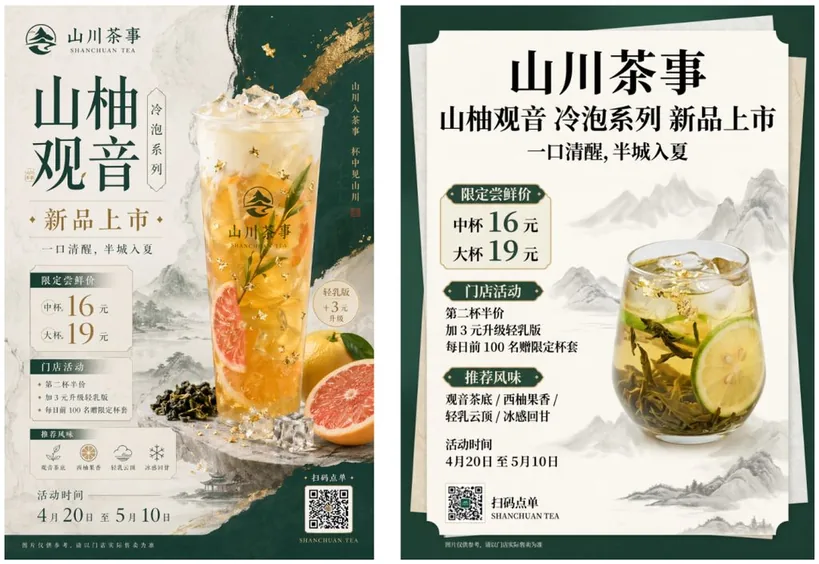
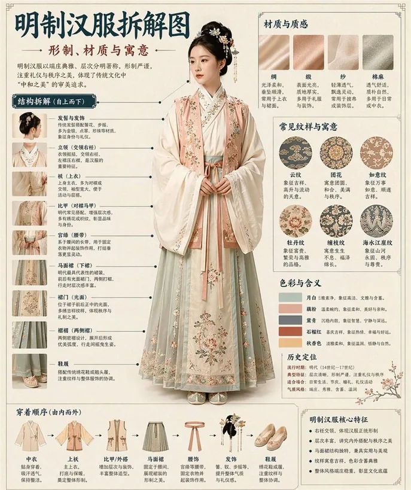
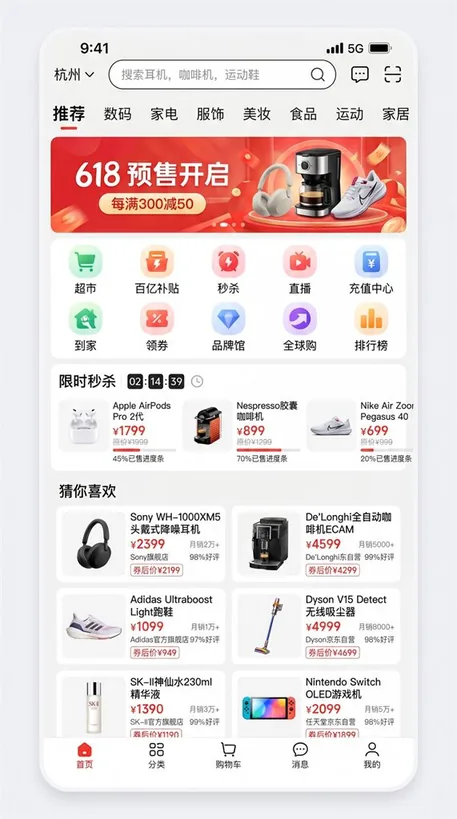
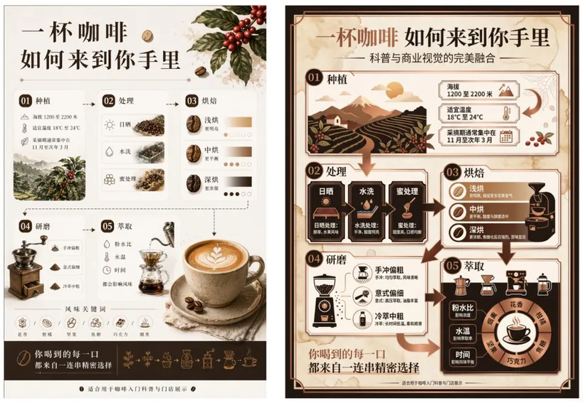
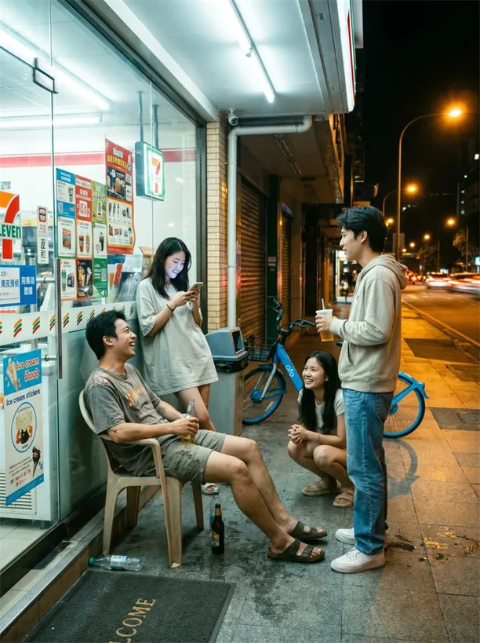

# image-prompt-architect

[中文](README.md) | **English**

> Turns a one-line image request into a production-ready visual brief — subject, composition, lighting, material, typography, aspect ratio and negative constraints, all settled at once.

An **Agent Skill / prompt-engineering knowledge base** for AI image generation (text-to-image and image-to-image). It follows the common `SKILL.md` convention, so it drops straight into Claude Code or any coding agent that supports skills.

Before, you were writing *"a cyberpunk cat, high quality, 8K."*
After, the model receives a brief a photographer could shoot from.

`12 deliverable recipes` · `5 reference files` · `analysis of 1,563 real prompts` · `MIT`

---

## See it in action

Every image below was written with this skill's recipe system. We deliberately picked the places generation usually falls apart — **CJK typography, dense copy, structural labelling, natural group interaction**:

<table>
  <tr>
    <td align="center" width="33%">
      <br>
      <sub><b>Poster / Typography</b><br>Tea launch poster, 3:4</sub>
    </td>
    <td align="center" width="33%">
      <br>
      <sub><b>Infographic / Knowledge visualisation</b><br>Ming-dynasty hanfu deconstructed, every label correct</sub>
    </td>
    <td align="center" width="33%">
      <br>
      <sub><b>UI / Commercial interface</b><br>E-commerce app home, high fidelity, 9:16</sub>
    </td>
  </tr>
  <tr>
    <td align="center" width="33%">
      <br>
      <sub><b>Advertising / Product</b><br>Skincare hero shot, price and gift tiers</sub>
    </td>
    <td align="center" width="33%">
      <br>
      <sub><b>Infographic / Process narrative</b><br>How a cup of coffee reaches you, five stages</sub>
    </td>
    <td align="center" width="33%">
      <br>
      <sub><b>Photography / Photoreal</b><br>Convenience store at 10pm, natural group interaction</sub>
    </td>
  </tr>
</table>

> Samples are drawn from the project's own corpus of 1,563 real prompts (scripted statistics plus close reading); the recipe system was distilled from it. Brands, people and prices shown are fictional.

## What it solves

| Common problem | What this skill does |
|---|---|
| Stacking adjectives, model drifts | Routes to one of **12 primary categories** first, then fills structured fields from that category's recipe |
| No idea how commercial images are written | Recipes for e-commerce hero shots, product KV, packaging, logo/VI, posters, infographics, UI, photography, illustration, 3D, character design, storyboards |
| Text always comes out garbled | Dedicated **text rendering** section: quoting, weight and tracking, character ceilings, layout anchors |
| Multi-panel sets drift apart | **Reference image & identity** and **multi-panel consistency** sections: lock the face, the layout, the palette |
| Everything breaks when you switch models | **Model adaptation** section on how different models prefer natural language, tags, or weights |
| Iteration is guesswork | **Iteration repair table**: symptom → cause → which field to change |

## Install

The skill follows the common `SKILL.md` directory convention — clone it into your agent's skills directory.

The primary repository is on [GitHub](https://github.com/yyyyzzzzzz/image-prompt-architect); [Gitee](https://gitee.com/zhang-wei678/image-prompt-architect) is a mirror for users in mainland China.

**Claude Code and similar**

```bash
# GitHub (primary)
git clone https://github.com/yyyyzzzzzz/image-prompt-architect.git \
  ~/.claude/skills/image-prompt-architect

# Gitee mirror (faster from mainland China)
git clone https://gitee.com/zhang-wei678/image-prompt-architect.git \
  ~/.claude/skills/image-prompt-architect
```

On Windows, use `C:\Users\<you>\.claude\skills\image-prompt-architect`.
Restart your session — once `image-prompt-architect` appears in the skills list, it's live.

## Usage

Describe the image in plain language; the skill fills in the parameters and returns a structured prompt:

```
a poster for a coffee shop opening, warm autumn tones, needs room for the address and a QR code
headphones product shot, white background, e-commerce hero style
turn this photo into a Ghibli-style illustrated avatar
a full set of UI prompts for my indie game
```

Output includes: the main prompt (ready to paste), replaceable slots (`{subject}`, `{background}` …), variation directions, and negative prompts.

<details>
<summary><b>See a full example: from one sentence to a paste-ready prompt</b></summary>

**You only say**: a new-style Chinese tea drink launch poster, 3:4.

**What the skill decides for you**: hero object (cold-brew tea with leaves, citrus, ice and a touch of gold leaf) → palette (deep green, off-white, gold) → material treatment (rice-paper texture, negative space, ink-wash accents) → layout (promotion hierarchy, price priority) → copy (frozen verbatim, no model improvisation).

**Main prompt**

```text
设计一张 3:4 竖版海报，用于宣传中国新式茶饮新品。采用新中式视觉风格，整体感觉轻奢、克制。
配色使用深绿色、米白色和金色，带有宣纸纹理、留白、山水点缀和现代版式设计。
主体：一杯视觉上很吸引人的冷泡茶，包含茶叶、柑橘、冰块，以及少量金箔细节。

海报必须准确展示以下精确中文文案：
"山川茶事" "山柚观音" "冷泡系列" "新品上市" "一口清醒，半城入夏"
"限定尝鲜价" "中杯 16 元" "大杯 19 元" "门店活动" "第二杯半价"
"加 3 元升级轻乳版" "每日前 100 名赠限定杯套"
"推荐风味" "观音茶底 / 西柚果香 / 轻乳云顶 / 冰感回甘"
"活动时间 4月20日 至 5月10日" "扫码点单" "SHANCHUAN TEA"
小字："图片仅供参考，请以门店实际售卖为准"

在保证整体高级感的同时，保持清晰的促销层级，不要做得廉价或过于电商化。
尤其注意小字、数字、价格、信息模块以及中文排版美感。
```

The prompt stays in Chinese on purpose — the poster's copy *is* Chinese, and the model has to be handed the exact glyphs it must render. Swap the copy for your own language and the same structure holds.

Note the last two lines: **draw the aesthetic boundary first (not cheap, not over-ecommerce), then name the usual failure points (small print, numerals, CJK typography).** That pair is the most overlooked part of the recipe, and the one that most affects the final image.

</details>

## What's inside

```
.
├── SKILL.md                      # entry point: triggers, workflow, quality gates
└── references/
    ├── taxonomy.md               # the 12 categories and the fast routing table
    ├── recipes.md                # per-type recipes (e-commerce / poster / logo / infographic / UI / …)
    ├── phrasebank.md             # vocabulary: shot size, lens, lighting, colour, material
    ├── examples.md               # 7 worked examples: one sentence → full prompt
    ├── library-insights.md       # analysis of 1,563 real prompts
    └── website-api.md            # optional: image generation API protocol reference
```

## Optional: generating images

By default the skill only writes prompts — no network, no auth code, no sign-up.

If you already have an image service wired up (OpenAI Images, ComfyUI, SD WebUI, …), the "generate image" section of `SKILL.md` can call it; `references/website-api.md` documents one API protocol (auth → submit → poll) that you can adapt to your own service. No keys or credentials are stored in this repository.

Writing prompts alone never needs this step.

## Privacy & safety

- No API keys, auth codes, or user data in this repository.
- When using a third-party image service, follow its content policy. For real people and brands, use licensed material or switch to fictional subjects.

## Contributing

Recipes, vocabulary and model-specific notes are all welcome:

1. Fork and create a branch;
2. Add recipes to `references/recipes.md` and vocabulary to `references/phrasebank.md`, keeping the existing numbering and the `field → value` table format;
3. New categories must also be registered in the routing table in `references/taxonomy.md`;
4. Open a PR stating which models the addition applies to and whether you have test samples.

## License

[MIT](./LICENSE)

---

If these recipes saved you a few rounds of redrawing, a **Star** is the most useful way to say thanks.
